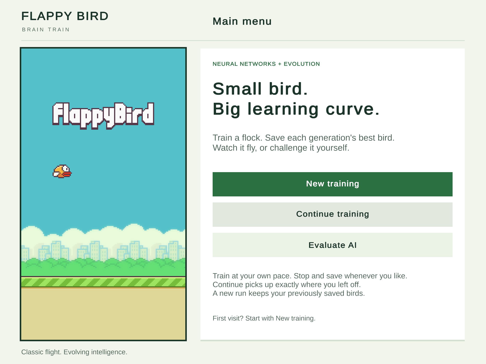
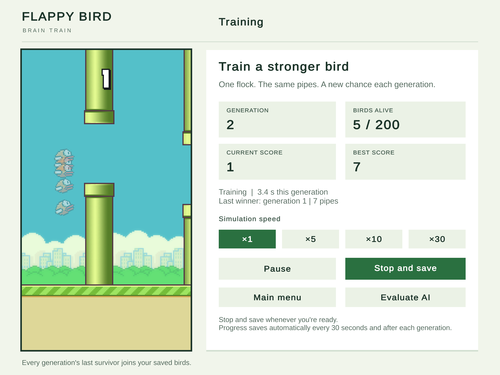
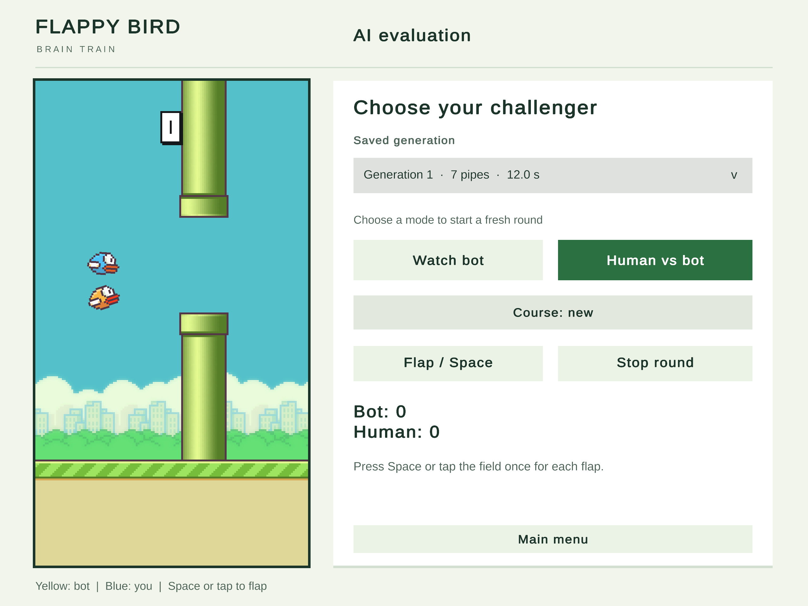

# Flappy Bird Brain Train

**A Flappy Bird game where the birds learn to fly.** Train a population of 200 agents,
save each generation's best bird, then watch it play or challenge it yourself.

Built with **Unity 6 · C# · Neural networks · Genetic algorithms**.



## Overview

The AI learns by evolving the weights of a feed-forward neural network. Every bird
in a generation faces the same pipes. The strongest genomes survive selection,
combine, and mutate to form the next population.

- **Train from scratch or continue:** restore the full simulation, population, and random state.
- **Watch or compete:** choose an archived generation, launch a bot round, or play Human vs bot.
- **Fair physical rules:** training, bots, and human input all use the same fixed-step simulation.
- **Inspect the implementation:** plain C# game logic, a 6 → 12 → 8 → 1 network, and a genetic algorithm with elitism, tournament selection, crossover, and mutation.
- **Readable presentation:** scalable TextMeshPro text, clear status cards, and the classic pixel-art field.

The project focuses on game AI, deterministic simulation, and separation of
game logic, presentation, and persistence. No machine-learning service is required.

## In-game previews

| Training | Human vs bot |
| --- | --- |
|  |  |

Open an image to inspect the full **2560 × 1920** capture. These are screenshots
rendered by Unity from the project, with a separate layout for training and evaluation.

## Getting started

**Unity version:** 6000.3.8f1.

1. Open the project in Unity Hub with the specified editor version.
2. Open [MainMenu.unity](Assets/Scenes/MainMenu.unity) and press **Play**.
   Alternatively, select **Flappy Bird > Open Main Menu** in the editor menu.
3. Choose **New training**, **Continue training**, or **Evaluate AI**.

To create a Windows build, select **Flappy Bird > Build Windows**. The output is
`Builds/Windows/FlappyBird.exe`. Keep its data directory and runtime files beside
the executable when sharing the build.

Training saves are local application data, not bundled project assets. On a clean
checkout, the evaluation list may be empty. Run New training first to create
saved agents.

Scenes are **MainMenu**, **Training**, and **AITest**, with MainMenu first in Build Settings.

## Reviewer walkthrough

1. Click **New training**. A population of 200 birds starts flying together.

2. Select **x10** or **x30** to accelerate training. Observe the generation number,
   surviving population, current score, and best score. Acceleration runs more
   simulation steps; it does not change the physics.

3. Wait until a generation finishes or only one bird remains. A saved brain is
   then available, and **Evaluate AI** becomes available. There is no automatic
   overall training limit: the user controls when training stops.

4. Click **Stop and save**. The simulation stops and writes a full checkpoint.
   Click **Evaluate AI** to open the saved-brain evaluation scene.

5. Choose an agent from **Saved generation**. The list includes archived generations
   from all saved runs. If generation numbers repeat, a run number distinguishes
   the options; run 1 is the newest archived run.

6. Choose **Course: new** to test generalization, or **Course: selected generation** to
   replay the course associated with that saved brain.

7. Click **Watch bot**. It immediately starts a one-bird round controlled by the
   selected neural network. No separate Start button is required.

8. Click **Human vs bot** to start a fresh two-bird round. Both birds wait until the
   first human flap. Press **Space**, tap/click the field, or click **Flap / Space** to
   start. Yellow is the bot; blue is the human.

9. Try switching between the two mode buttons or restarting the same mode.
   Each click creates a fresh round with the correct bird count and cleared
   input state. The generation and course selectors unlock after **Stop round**
   or natural completion.

10. Return to **Main menu** and select **Continue training**. The last saved generation,
    population, birds, pipes, and random-generator states are restored rather
    than creating a new population. Stop and save again when finished reviewing.

Early agents can crash quickly. Training quality depends on initialization,
training duration, and course difficulty. Performance is not guaranteed to
improve in every generation, particularly because courses change.

## Game rules and controls

- Space, a field tap/click, or Flap / Space requests one human flap.
  Holding the key does not continuously flap.
- Watch bot plays automatically; human input does not control that bird.
- In competition, both participants face the same pipes and physical rules.
  Birds do not collide with each other.
- A bird crashes on contact with a pipe, the ground, or the ceiling.
- Each fully cleared pipe awards one point to the surviving bird.
- If one participant crashes, the other continues flying.
- The longer survivor wins a completed competition. Crashing on the same
  simulation tick is a draw. Manual stopping does not declare a winner.
- Stop round or Escape stops evaluation. Escape in training stops and saves it.
- The pointing-hand hint appears only before the first flap of Human vs bot.
  Scores use separate numeric sprites, including the actual digit 1.

## Shared simulation

`FlappyWorld` is the source of truth for movement, collisions, scoring, and pipes.
Training and both evaluation modes use this same class at a fixed step of
1/60 second. The renderer displays the resulting state and does not determine
collisions or fitness.

Each step reads bot decisions, moves pipes, applies flap velocity and gravity,
advances bird positions, resolves collisions, and updates individual scores.
A dead bird is processed only once. A visual falling animation after a crash
does not change its recorded survival result.

The field is 288 by 512 pixels, with a 112-pixel ground area. Pipes are 52 pixels
wide with a 100-pixel opening. Pipe speed is 120 pixels per second; gravity is
900 pixels per second squared; flap velocity is 270 pixels per second upward.
These rules recreate familiar Flappy Bird behavior rather than claiming exact
binary equivalence to the closed original game.

## Neural network

The network topology is **6 -> 12 -> 8 -> 1**, with **197 weights and biases** in total.
Hidden layers use `tanh`, and the output uses `sigmoid`. An output greater than 0.5
requests a flap.

The six normalized inputs are:

1. Bird height above the ground.
2. Vertical velocity, distinguishing rising from falling.
3. Horizontal distance to the next pipe.
4. Signed vertical distance to the gap center.
5. Signed vertical distance to the top of the gap.
6. Signed vertical distance to the bottom of the gap.

Inference is feed-forward and does not modify weights or accumulate signals
between steps. Weights are learned through evolution rather than backpropagation.

## Genetic algorithm

A new training run initializes 200 random genomes. All birds in one generation
start together and encounter an identical course. The next generation receives
a new course to reduce dependence on one fixed obstacle sequence.

Fitness primarily measures survival in simulation ticks. Ties use pipe count,
distance to the gap center at death, and a stable individual index.

Default evolution settings:

- Preserve four elite genomes unchanged.
- Use tournaments of four candidates to select each parent.
- Apply uniform crossover across weights and biases.
- Mutate each non-elite gene with an 8 percent probability, using small Gaussian
  perturbations with strength 0.3.
- Introduce 5 percent newly randomized individuals to maintain exploration.

Genomes are deep-copied so offspring mutation cannot alter parents or elites.
The last living bird is archived immediately, even if it keeps flying. Its
generation continues until it crashes or the user stops training. When it dies,
the archive receives the final result and the next generation starts.

## Saving and continuation

Files are stored under `Application.persistentDataPath/Training`. Each training run
has its own directory, and `latest.txt` identifies the run to continue.

- `checkpoint.json` stores the full population, settings, world, generation,
  simulation tick, and random-generator states.
- `checkpoint.json.bak` retains the previous successful checkpoint.
- `generation-XXXXXXXX.json` stores a generation's winning brain and result.
  A still-living survivor is explicitly marked as an unfinished generation.

Saving occurs after generations, when one survivor remains, every 30 real
seconds, on pause/backgrounding, on application exit, and before leaving
training. Temporary files and atomic replacement protect completed writes.
A failed save pauses training and blocks the requested navigation.

Readable JSON is accompanied by an exact numeric payload because Unity's JSON
parser can otherwise round some double values. Restoring exact values and
random-generator states allows continuation to match uninterrupted execution.
The loader validates the format and tries the backup if a checkpoint is damaged.

New training creates a separate run and keeps earlier archived agents. Continue
training restores the latest saved state, including an unfinished generation.

Earlier text files named `Bot N Weights.json` are not compatible checkpoints. They are left in the user's data directory.

## Project structure

| Location | Responsibility |
| --- | --- |
| [Assets/Scripts/Core](Assets/Scripts/Core) | Plain C# simulation, neural inference, genomes, evolution, training and evaluation sessions, deterministic randomness. |
| [Assets/Scripts/Persistence](Assets/Scripts/Persistence) | Repository interface, file management, validation, and exact numeric serialization. |
| [Assets/Scripts/Presentation](Assets/Scripts/Presentation) | Scene interfaces, input, board rendering, shared controls, and navigation. |
| [Assets/Editor](Assets/Editor) | Commands to open the main menu and build the Windows player. |
| [Assets/Tests](Assets/Tests) | Unity Edit Mode persistence tests and Play Mode scene/UI regression tests. |
| [Tests/CoreChecks](Tests/CoreChecks) | Standalone checks of physics, neural inference, evolution, continuation, and evaluation state transitions. |

This separation keeps simulation independent of presentation, allows storage
substitution through an interface, and keeps training and evaluation rules
consistent. EvaluationSession owns its mode, population, actions, and lifecycle
together, preventing one-bird/two-bird state mismatches during mode switches.

## Tests

In Unity, open **Window > General > Test Runner** and run the Edit Mode and Play Mode
tests. The tests cover checkpoint recovery, exact continuation, replay of an
archived winner, scene transitions, direct mode launches, repeated switching,
restart after completion, the first-flap gate, and the score/hint regression.
Tests use isolated temporary save directories instead of the user's training.

Play Mode tests also check that visible interface text fits its bounds and write
2560 × 1920 preview images to `TestResults/Previews`. The selected documentation
images are stored in `Docs/Images` so they are visible in a fresh GitHub checkout.

To run core checks outside Unity, use .NET SDK 10 from the project root:

```powershell
dotnet run --project Tests/CoreChecks/CoreChecks.csproj --configuration Release
```

To also run a seeded learning smoke test:

```powershell
dotnet run --project Tests/CoreChecks/CoreChecks.csproj --configuration Release -- --training-smoke
```

The Unity game itself does not require that external .NET SDK.

## Assets and attribution

The classic pixel-art atlas is retained at `Assets/Resources/FlappyAtlas.png`.
It is a true PNG imported without texture compression or mipmaps, with point
filtering. At the 1280 × 960 reference layout, each source pixel covers a 3 × 3
display area. The UI uses a pixel-aligned canvas and a signed-distance-field font
so text scales cleanly while the game retains its pixel-art appearance.

The atlas came with the original project; its attribution and rights remain
those of its original creator. This project is an independent learning exercise.
The Liberation Sans font and its SIL Open Font License are included under
`Assets/TextMesh Pro/Fonts`. TextMeshPro resources and shaders come from the
Unity UI package's Essential Resources.

## Further reading

- [Project guide](Docs/PROJECT_GUIDE.md): detailed simulation, AI, evolution, and persistence explanations.
- [Logic audit](Docs/LOGIC_AUDIT.md): original logical defects and their corrections.
